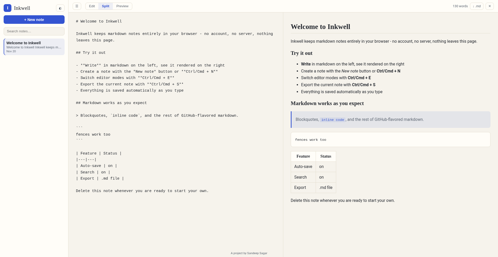

# Inkwell



A fast markdown notes app that runs entirely in the browser. Write in markdown with a live preview, keep as many notes as you like, search across all of them, and export any note as a `.md` file. No account, no server - notes are saved in your browser's local storage and never leave the page.

## Features

- **Live markdown preview** - GitHub-flavored markdown (tables, task lists, strikethrough, code fences) rendered as you type, in edit, split, or preview mode
- **Multiple notes with auto-save** - everything persists to local storage, debounced, as you type
- **Full-text search** across all notes, ordered by most recently edited
- **Keyboard shortcuts** - `Ctrl/Cmd + N` new note, `Ctrl/Cmd + E` switch editor mode, `Ctrl/Cmd + S` export
- **Export to .md** - download any note as a markdown file
- **Light and dark themes**, remembered between visits
- **Responsive** - sidebar collapses on small screens
- **Safe rendering** - rendered HTML is stripped of scripts, inline handlers, and `javascript:` links

## Tech

React + Vite, with [marked](https://marked.js.org) for parsing. The note store (`src/lib/notes.js`) and markdown pipeline (`src/lib/markdown.js`) are pure, dependency-light modules with their own test suites.

## Run locally

```bash
npm install
npm run dev
```

## Tests

```bash
npm test
```

Vitest covers the note store (titles, search, update/delete, persistence round-trips and corrupt-data handling) and the markdown renderer (GFM output, script stripping, link neutralization).

## Build

```bash
npm run build   # static files to dist/
```

Deployed on Render as a static site: `npm install && npm test && npm run build`, publish directory `dist`.

A project by Sandeep Sagar
